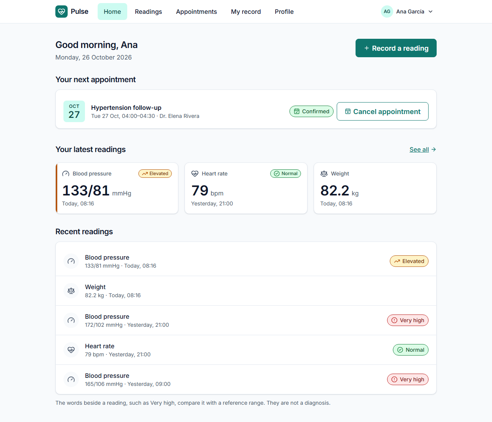
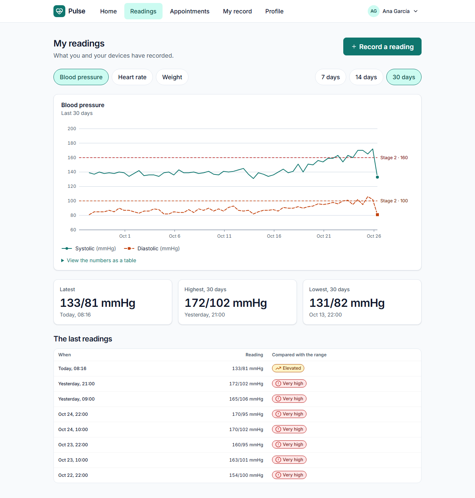
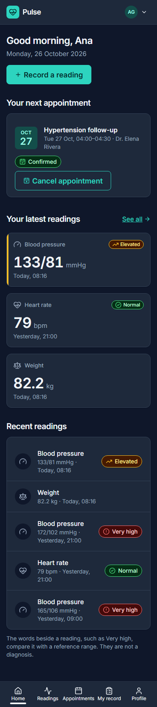
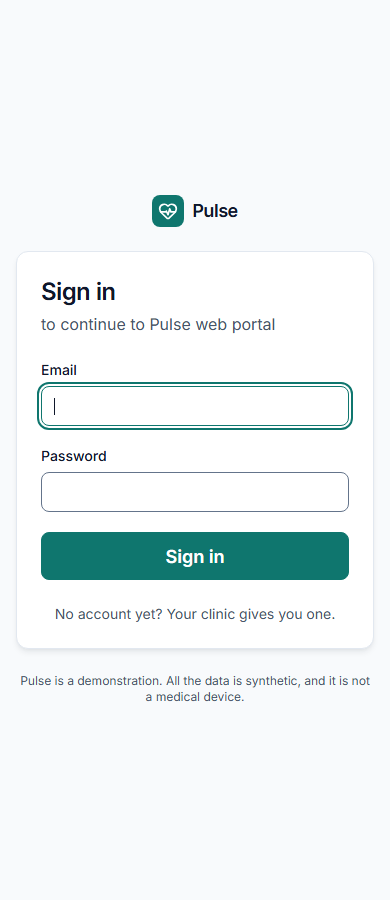

# Pulse

Remote patient monitoring and appointment coordination on **FHIR R4**, written in **Clojure** and **ClojureScript**, with single sign-on through **Keycloak**.

A portfolio project: four applications of different kinds share one identity provider and one FHIR server. All the data is synthetic.

<p align="center">
  
</p>

| | |
|---|---|
|  |   |

*The patient portal (server-rendered, works with and without JavaScript) and the Keycloak sign-in, both made from the same design system. Screenshots come from `bb web:journey --shots`.*

## Status

**Phases 0 to 7 are done; Phase 8 (the clinical workspace) is under way.** About 3,040 tests (2,530 on the JVM and 510 on Node), 29 architecture decision records, and an acceptance journey of the patient portal in a real browser against the real Keycloak (62 checks).

| Part | State |
|---|---|
| Local infrastructure: PostgreSQL, Keycloak 26.0.0 with the `pulse` realm, HAPI FHIR R4 | Done |
| FHIR core library and a deterministic synthetic cohort | Done |
| `api`: token verification, authorization by role and patient compartment, clinical endpoints, OpenAPI with Swagger UI, CORS and security headers | Done |
| `scheduler`: jobs as data, a rules engine that raises each alert once, a device simulator and appointment reminders | Done |
| Design system: tokens with measured contrast, shared components, mock-ups and the Keycloak login theme | Done |
| `web`, the patient portal: its own PKCE sign-in, server-side sessions, readings, appointments, record and profile | Done |
| `spa`, the clinical workspace in ClojureScript (shadow-cljs, Reagent 2, re-frame, keycloak-js) | Sign-in with PKCE, a token that renews when a call needs it, a role gate, sign-out the panel of patients (the most urgent first, with filters and a search that live in the address) and the chart of a patient (the alerts with the rule that raised each, the latest readings, a chart with its thresholds, the record and the appointments) done; the alert inbox and the appointments next |

Progress is tracked in [docs/02-implementation-plan.md](docs/02-implementation-plan.md).

## Try it

Needs Docker, Babashka and the Clojure CLI.

```
bb doctor
bb up
bb seed
bb dev
```

Open <http://localhost:4000/docs/> (Swagger UI): Authorize signs you in as a demo user, and the same request is answered differently for a patient, a practitioner and the administrator. Open <http://localhost:3300> for the patient portal and sign in as `ana.garcia@pulse.test`; the password is `DEMO_USER_PASSWORD` in the `.env` that `bb up` creates. Within a minute the simulated devices raise alerts, which Dr. Rivera finds in `GET /api/alerts`.

Other useful tasks: `bb check` (format, lint and tests, what CI runs), `bb web:journey` (a patient's journey in a real browser) and `bb design:build` (the mock-ups, then open `design/dist/index.html`).

## The four apps

| App | Kind | Who uses it | What it does |
|---|---|---|---|
| `api` | Resource server / FHIR gateway | The other apps | Validates tokens, enforces role and patient-compartment access, aggregates FHIR data |
| `web` | Server-rendered web app | Patients | Patient portal: summary, vitals trends, medication, appointments |
| `spa` | Single-page app (ClojureScript) | Clinicians | Patient panel, charts, alert inbox, schedule |
| `scheduler` | Background worker | Service account | Clinical rules, reminders and a device simulator |

## Stack

Clojure 1.12 · Ring, Reitit, malli, Integrant · Hiccup + htmx · ClojureScript, shadow-cljs, Reagent 2, re-frame · Keycloak 26.0.0 · HAPI FHIR (R4) on PostgreSQL · Babashka tasks · Tailwind CSS 4 + daisyUI 5 · GitHub Actions.

## Documentation

- [Architecture decision records](docs/adr/): why each important choice was made.
- [Stack review](docs/01-stack-review.md): what was kept, upgraded, replaced and why.
- [Implementation plan](docs/02-implementation-plan.md): concept, architecture and phases 0-10.
- [Extras backlog](docs/03-extras-backlog.md): everything deliberately left for later.
- [CLAUDE.md](CLAUDE.md): working notes for the AI assistant (Claude Code) that helps build this project. They describe each part of the code in detail and show how the project is worked on.

## Disclaimer

All data is synthetic. This is not a medical device, the clinical thresholds are didactic only, and it must not be used with real patient data.

## License

[MIT](LICENSE). Third-party material (LOINC, UCUM, Inter, Lucide, htmx and others) keeps its own terms; see [NOTICE](NOTICE).
