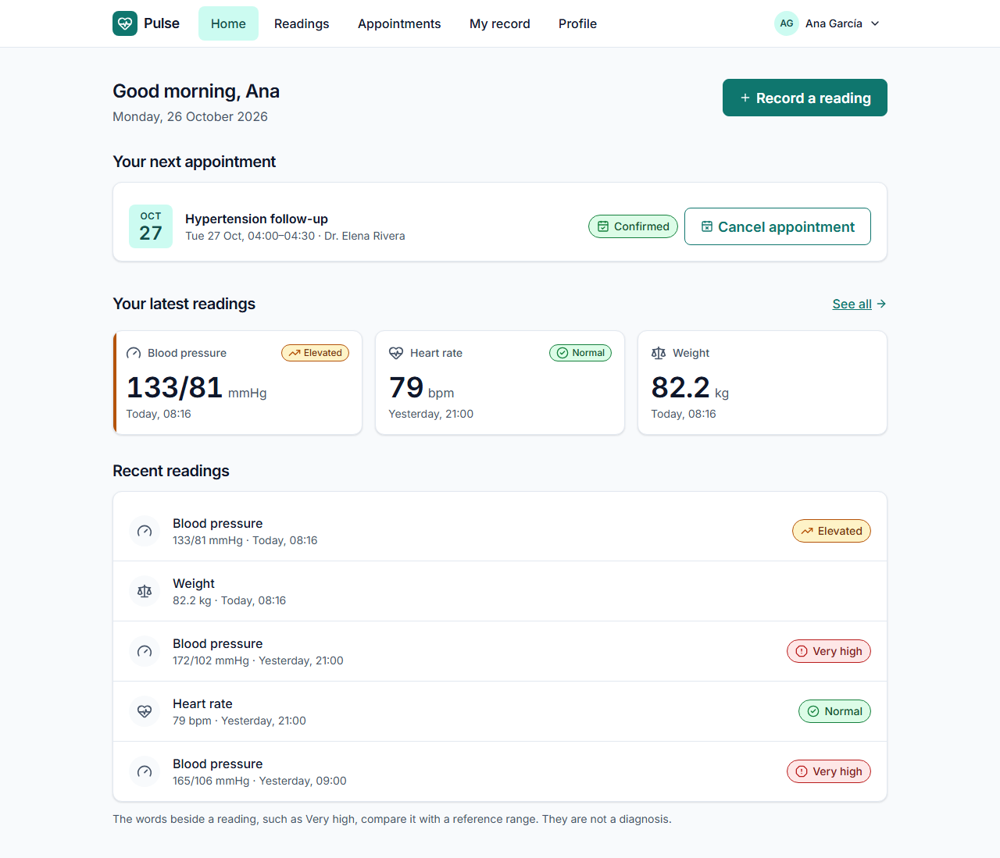
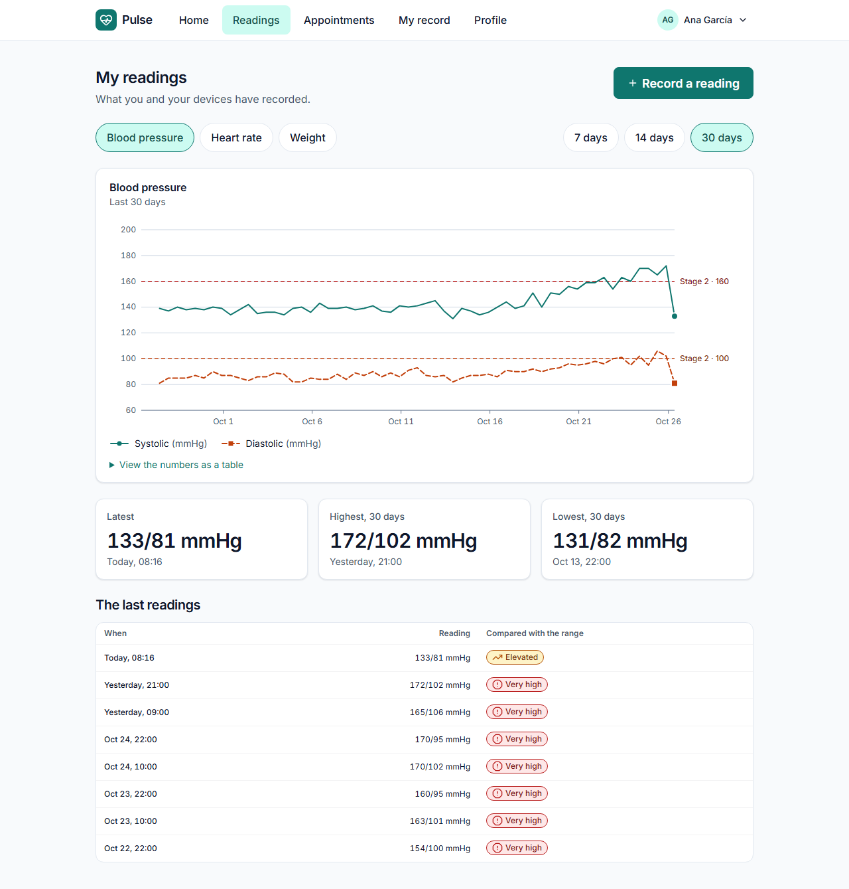
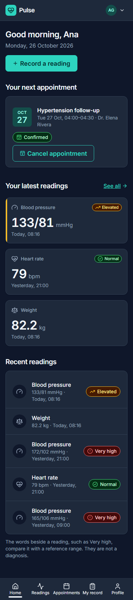
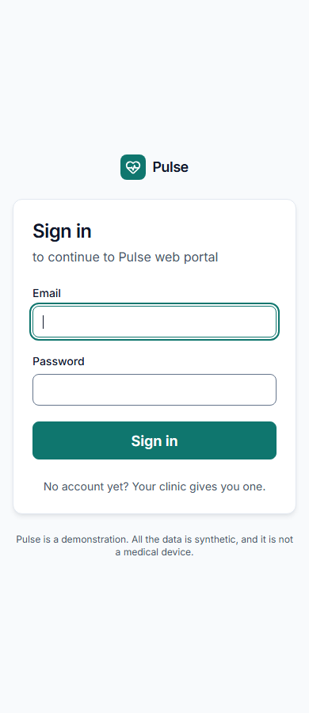
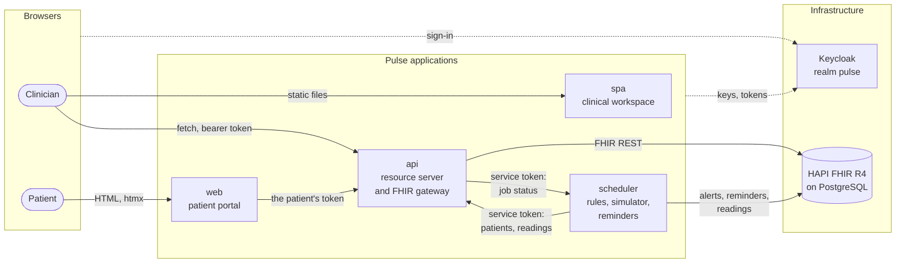

# Pulse

[](https://github.com/hannmtz-85/clj-pulse/actions/workflows/ci.yml)
[](https://github.com/hannmtz-85/clj-pulse/actions/workflows/integration.yml)
[](LICENSE)

Remote patient monitoring and appointment coordination on **FHIR R4**, written in **Clojure** and **ClojureScript**, with single sign-on through **Keycloak**.

A portfolio project: four applications of different kinds share one identity provider and one FHIR server, and each one signs in the way that suits it. All the data is synthetic.

<p align="center">
  
</p>

| | |
|---|---|
|  |   |

*The patient portal (server-rendered, works with and without JavaScript) and the Keycloak sign-in, both made from the same design system. Screenshots come from `bb web:journey --shots`.*

## What it does

A **patient** records readings from home (blood pressure, heart rate, oxygen saturation, glucose, weight, temperature), follows their trend against clinical thresholds, and asks for or cancels appointments. Simulated devices keep sending readings, and a **scheduler** applies clinical rules to them, raises each alert once, and writes appointment reminders. A **clinician** opens a ClojureScript workspace: the panel of their patients with the most urgent first, the chart of each one, an inbox of alerts to acknowledge, and the appointments to confirm, move or cancel. Everything goes through one **api** that decides, for each caller, which records they may see.

**Status:** built as planned: the infrastructure, the FHIR core, the four applications, the design system, the containers and the CI are done and tested ([the plan](docs/02-implementation-plan.md)). What was left out on purpose is in [the backlog](docs/03-extras-backlog.md).

## Architecture



| App | Kind | Who uses it | How it signs in |
|---|---|---|---|
| [`api`](apps/api) | Resource server and FHIR gateway (Ring, Reitit, Jetty) | The other apps, and Swagger UI | Verifies bearer tokens; decides by role and by patient what each caller may see |
| [`web`](apps/web) | Server-rendered portal (Hiccup 2, htmx) | Patients | Its own authorization-code flow with PKCE, a server-side session and a token keeper for each session |
| [`spa`](apps/spa) | Single-page app (ClojureScript, Reagent 2, re-frame) | Practitioners and the administrator | keycloak-js with PKCE; the token stays in memory |
| [`scheduler`](apps/scheduler) | Background worker (Integrant, core.async) | Nobody: it works on its own | Client credentials; its own small HTTP surface is closed to everything but the api |

Clojure 1.12 · Ring, Reitit, malli, Integrant, Telemere · Hiccup + htmx · ClojureScript, shadow-cljs, Reagent 2, re-frame · Keycloak 26.0.0 · HAPI FHIR (R4) on PostgreSQL · Babashka tasks · Tailwind CSS 4 + daisyUI 5 · GitHub Actions. More diagrams (trust boundaries, the path of a reading until it becomes an alert) are in [the architecture page](docs/technical/architecture.md).

## Try it

You need Docker (about 4 GB of RAM free for everything), JDK 21, the Clojure CLI, Babashka, Node 22 and Git. `bb doctor` checks them, the RAM and the ports.

```
bb doctor   # the tools, the RAM and the ports
bb up       # PostgreSQL, Keycloak and HAPI FHIR; creates .env with random secrets
bb seed     # the synthetic cohort (about 700 resources)
bb apps     # the four applications as containers (about ten minutes the first time, one after)
bb smoke    # asks the containers what only they can answer: health, tokens, a real sign-in
```

Then open the portal at <http://localhost:3300>, the clinical workspace at <http://localhost:3000> and Swagger UI at <http://localhost:4000/docs/>. Use `localhost`, not `127.0.0.1`: the realm's redirect addresses name it. Stop everything with `bb down` (`bb reset` also destroys the data).

Demo users (local only). Their password is `DEMO_USER_PASSWORD` in the `.env` that `bb up` creates:

| User | Role | Try |
|---|---|---|
| `ana.garcia@pulse.test` | patient | The portal. Her readings are very high, so there is something to read |
| `noah.kim@pulse.test` | patient | The portal with no readings yet |
| `dr.rivera@pulse.test` | practitioner | The workspace: her panel, a patient's chart, the inbox of alerts |
| `admin@pulse.test` | clinic administrator | The workspace with every patient, and the status of the scheduler's jobs |

`dr.okafor@pulse.test`, `liam.chen@pulse.test`, `sofia.rossi@pulse.test`, `omar.haddad@pulse.test` and `maya.patel@pulse.test` complete the cohort. A patient is told that the workspace is for the clinic, and a practitioner that the portal is for patients.

Things worth trying:

1. **As Ana, record a reading** with a diastolic pressure of 310. The api refuses it and the form shows the api's own words beside the field.
2. **As Dr. Rivera, wait a minute.** The simulated devices have one abnormal episode in turn, the rules engine raises the alerts, and they appear in the inbox; acknowledge one.
3. **In Swagger UI, press Authorize** and sign in as each user: the same request is answered differently for a patient, a practitioner and the administrator, and a practitioner is refused a patient who is not on their panel.

To work on it instead: `bb dev` runs the api, the scheduler and the portal in one JVM (`bb dev lite` uses an in-memory FHIR server), `bb spa` serves the workspace with hot reload (`npm ci` once in `apps/spa`), and `bb check` runs what CI runs. The acceptance in a real browser is `bb web:journey` and `bb spa:journey`, and `bb design:build` makes the mock-ups (open `design/dist/index.html`). Every task is described in [CLAUDE.md](CLAUDE.md) and in [the tooling page](docs/technical/build-and-tooling.md).

## What it demonstrates in Clojure

- **Data as the design.** The route table of the api is data, and a route without an `:authz` entry stops the start-up ([`routes.clj`](apps/api/src/pulse/api/routes.clj)); the permission matrix is data too ([`authz.clj`](apps/api/src/pulse/api/authz.clj), [ADR-0012](docs/adr/0012-authorization-by-scope.md)). Jobs are data and `next-run` is a pure function ([`schedule.clj`](apps/scheduler/src/pulse/scheduler/schedule.clj)); a clinical rule is data that `defrule` keeps both as running code and as the quoted form a person can read ([`rules.clj`](apps/scheduler/src/pulse/scheduler/rules.clj)). The design tokens are EDN, and the theme and the contrast checks are generated from them ([`tokens.edn`](design/tokens.edn), [`design.clj`](tools/design.clj)); the nginx configuration of the workspace is generated from the data of its Ring server ([`nginx.clj`](apps/spa/src/pulse/spa/nginx.clj)).
- **One codebase, three runtimes.** `.cljc` code runs on the JVM, in the browser and in Babashka: the FHIR model and the appointment lifecycle ([`libs/fhir`](libs/fhir)), the components as hiccup, rendered by Hiccup 2 on the server and by Reagent in the browser ([`libs/ui`](libs/ui)), and how times and numbers are written, held to what `java.time` writes by a generated parity table ([`libs/view`](libs/view)). The mock-ups are built from the very pages the applications serve.
- **Identity done four ways.** Token verification on Nimbus with the policy in Clojure ([`jwt.clj`](libs/platform/src/pulse/platform/jwt.clj), [ADR-0009](docs/adr/0009-access-token-verification-with-nimbus-facade.md)); a portal with its own authorization-code flow, server-side sessions and CSRF checks ([`signin.clj`](apps/web/src/pulse/web/signin.clj), [`session.clj`](apps/web/src/pulse/web/session.clj), [ADR-0028](docs/adr/0028-the-patient-portal-a-server-side-client-of-the-api-with-its-own-sign-in-and-a-token-keeper-for-each-session.md)); keycloak-js in the workspace, with the token never in the application state ([`auth.cljs`](apps/spa/src/pulse/spa/auth.cljs), [ADR-0029](docs/adr/0029-the-clinical-workspace-a-browser-client-of-the-api-with-keycloak-js-re-frame-and-the-pages-of-the-mock-ups.md)); and client credentials between services, cached and renewed early ([`token.clj`](libs/platform/src/pulse/platform/token.clj)).
- **FHIR R4 on HAPI.** An alert is raised once because it is a conditional create by identifier ([`create-once!`](libs/fhir/src/pulse/fhir/client.clj), [ADR-0022](docs/adr/0022-rules-engine-rules-as-data-alerts-raised-once.md)); the in-memory FHIR server the tests use is held to HAPI's behaviour by contract tests ([`memory.clj`](libs/fhir/src/pulse/fhir/client/memory.clj)); the lifecycle of an appointment says who may do what, and the api, the portal and the workspace all ask it ([`appointment.cljc`](libs/fhir/src/pulse/fhir/appointment.cljc)).
- **Concurrency.** The summary of a patient fans out about twelve FHIR queries on virtual threads under one deadline, and what fails is said and not hidden ([`fanout.clj`](libs/platform/src/pulse/platform/fanout.clj), [ADR-0013](docs/adr/0013-patient-summary-fan-out.md)); simulated readings go through a core.async pipeline into FHIR transactions ([`pipeline.clj`](apps/scheduler/src/pulse/scheduler/pipeline.clj), [ADR-0023](docs/adr/0023-device-simulator-core-async-pipeline-to-a-fhir-transaction.md)); an executor whose jobs never overlap themselves ([`executor.clj`](apps/scheduler/src/pulse/scheduler/executor.clj)).
- **ClojureScript with re-frame.** Each page of the workspace is a small pure state machine, the same `.cljc` on the JVM and on Node, with the effects at the edge ([`panel.cljc`](apps/spa/src/pulse/spa/panel.cljc), [`inbox.cljc`](apps/spa/src/pulse/spa/inbox.cljc), [`fetch.cljs`](apps/spa/src/pulse/spa/fetch.cljs)); the table of routes is checked when it loads ([`route.cljc`](apps/spa/src/pulse/spa/route.cljc)); every page has its states, and a test holds the routes to them.
- **Tests as evidence.** About 4,280 tests (3,110 on the JVM, 1,172 on Node) with property tests, contract tests against a real HAPI, and mutation analysis whose survivors became tests ([how](docs/technical/testing-strategy.md)). Two acceptance journeys drive a real browser over the DevTools protocol against the real Keycloak ([`web/journey.mjs`](apps/web/journey.mjs), 62 checks; [`spa/journey.mjs`](apps/spa/journey.mjs), 225 checks, with axe-core and the keyboard), and `bb smoke` checks the running containers ([`smoke.clj`](tools/smoke.clj), 24 checks).
- **Packaging.** Jars compiled ahead of time, two Dockerfiles, nginx for the workspace, a compose profile, and a CI that runs `bb check` on every push ([ADR-0030](docs/adr/0030-packaging-the-apps-compiled-uberjars-two-dockerfiles-nginx-for-the-workspace-and-a-compose-profile.md)).

## Limits

Read these before judging it; each is written down with its reason.

- **Not a medical device.** The data is synthetic, the clinical thresholds are didactic, and it must not be used with real patient data.
- **Local only.** Everything binds to `127.0.0.1`, Keycloak runs in development mode with no HTTPS, and no image is published.
- **HAPI has no authentication.** The api is the one policy point for clinical reads, and the scheduler writes to HAPI directly. In a real deployment, isolating HAPI would be the first thing to do ([trust boundaries](docs/technical/architecture.md#trust-boundaries)).
- **Tokens are verified without asking Keycloak,** so one stays valid for up to five minutes after its owner signs out. The portal's sessions live in memory: one process, and a restart ends them.
- **The devices are simulated,** and a reminder is written to FHIR as a `Communication`: nothing sends it to the patient.
- **What was left out on purpose** is in [the extras backlog](docs/03-extras-backlog.md), with why.

## Documentation

- [Documentation index](docs/index.md): a functional description of each app for a non-technical reader, and the technical documentation (architecture, identity, FHIR model, each app, design system, testing, tooling and the decisions).
- [Architecture decision records](docs/adr/): why each important choice was made (30 of them).
- [Stack review](docs/01-stack-review.md): what was kept, upgraded, replaced and why.
- [Implementation plan](docs/02-implementation-plan.md): concept, architecture and phases 0-10.
- [Extras backlog](docs/03-extras-backlog.md): everything deliberately left for later.
- [CLAUDE.md](CLAUDE.md): working notes for the AI assistant (Claude Code) that helps build this project. They describe each part of the code in detail and show how the project is worked on.

## Disclaimer

All data is synthetic. This is not a medical device, the clinical thresholds are didactic only, and it must not be used with real patient data.

## License

[MIT](LICENSE). Third-party material (LOINC, UCUM, Inter, Lucide, htmx and others) keeps its own terms; see [NOTICE](NOTICE).
