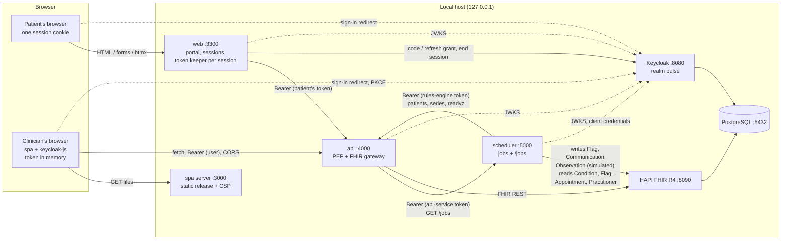
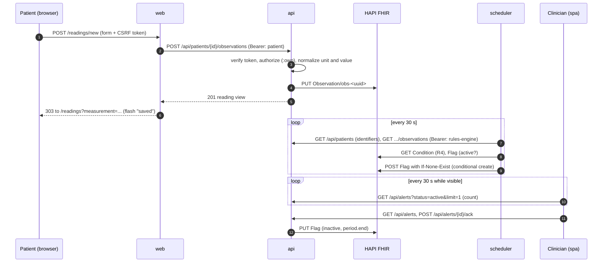
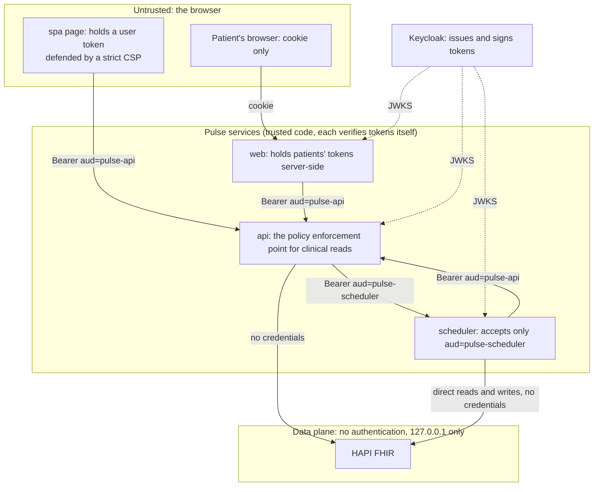

# Architecture

> Components, data flow and trust boundaries of Pulse as it is after Phase 9. The README has a shorter diagram of the same components. Each part has its own page (see [index.md](index.md)); the reasons are in [decisions.md](decisions.md) and the ADRs.

## Components

| Component | Kind | Port (127.0.0.1) | Code | Decided in |
|---|---|---|---|---|
| `api` | Resource server and FHIR gateway (Ring, Jetty, Reitit) | 4000 | `apps/api` | ADR-0011, ADR-0012 |
| `web` | Patient portal, server-rendered (Hiccup 2, htmx), confidential OIDC client | 3300 | `apps/web` | ADR-0028 |
| `spa` | Clinical workspace, ClojureScript SPA (Reagent 2, re-frame, keycloak-js), public OIDC client; served by a small Ring server in release | 3000 | `apps/spa` | ADR-0029 |
| `scheduler` | Jobs (rules engine, device simulator, reminders) and its own small resource server | 5000 | `apps/scheduler` | ADR-0019 – ADR-0024 |
| Keycloak 26.0.0 | Identity provider, realm `pulse` | 8080 (management 9000) | `infra/keycloak`, `tools/realm.clj` | ADR-0006 |
| HAPI FHIR JPA Starter (`hapiproject/hapi:v8.12.0-2`) | FHIR R4 server | 8090 (`/fhir`) | `infra/hapi` | ADR-0002 |
| PostgreSQL 16 | Storage of Keycloak and HAPI (two databases) | 5432 | `infra/postgres`, `compose.yaml` | Plan Phase 2 |

Shared libraries ([02-implementation-plan.md](../02-implementation-plan.md) §4, `CLAUDE.md`):

| Library | Platform | Holds |
|---|---|---|
| `libs/fhir` | `.cljc` (+ JVM/bb clients) | FHIR resources as maps, malli schemas, units, bands, the measurement catalogue, the appointment lifecycle, the alert lifecycle, the `FhirClient` protocol with HTTP and in-memory implementations, the synthetic cohort |
| `libs/platform` | JVM | Config (Aero + malli), logging (Telemere), JWT verification (Nimbus facade), HTTP mechanisms (problems, request id, auth, CORS, headers, router), service tokens, the client of another Pulse service, fan-out, Integrant components |
| `libs/ui` | `.cljc` | Presentational components as hiccup, icons, SVG charts, layouts (portal, workspace, Keycloak login) |
| `libs/view` | `.cljc` | How times, numbers, readings, alerts and jobs are written, shared by the portal (JVM), the workspace (browser) and the mock-ups (Babashka) |

`design/` holds the tokens, the generated themes and the mock-ups; `tools/` the Babashka tasks; `dev/` the one-JVM development system (`pulse.dev`).

## Component diagram

Sources: `compose.yaml`; [ADR-0018](../adr/0018-cors-and-security-headers.md) (CORS for the workspace only); [ADR-0022](../adr/0022-rules-engine-rules-as-data-alerts-raised-once.md) (the engine reads through the api and writes to FHIR); [ADR-0023](../adr/0023-device-simulator-core-async-pipeline-to-a-fhir-transaction.md); [ADR-0024](../adr/0024-appointment-reminders-a-communication-sent-once-from-what-fhir-holds.md); [ADR-0025](../adr/0025-job-status-through-the-api-its-own-service-account-and-a-role-for-it.md).

## The four OAuth 2.0 flows

The project uses four kinds of client on purpose ([ADR-0029](../adr/0029-the-clinical-workspace-a-browser-client-of-the-api-with-keycloak-js-re-frame-and-the-pages-of-the-mock-ups.md), "Alternatives considered"). Details: [identity-and-tokens.md](identity-and-tokens.md).

| Client | Flow | Where the tokens live |
|---|---|---|
| `pulse-web` | Authorization code + PKCE S256, confidential (secret), `state` and `nonce` | On the portal's server, in a keeper per session; the browser has an opaque cookie |
| `pulse-spa` | Authorization code + PKCE S256, public, through keycloak-js | In the keycloak-js object in the page; never in the re-frame state or any storage |
| `pulse-docs` | Authorization code + PKCE S256, public (Swagger UI) | In the Swagger UI page, not persisted |
| `pulse-scheduler`, `pulse-api` | Client credentials (HTTP Basic) | In memory, cached and renewed early |

## Data flow: a reading becomes an alert

Sources: [ADR-0014](../adr/0014-recording-and-reading-observations.md), [ADR-0016](../adr/0016-alerts-inbox-and-acknowledgement.md), [ADR-0022](../adr/0022-rules-engine-rules-as-data-alerts-raised-once.md), ADR-0028 (update of 2026-10-23), ADR-0029 (update of 2026-10-31).

## Data flow: the patient summary (fan-out)

`GET /api/patients/{id}/summary` runs about twelve FHIR queries at once on virtual threads under one deadline (4 s by default); a section that fails or is late is `null` and listed in `unavailable`, the patient section is required ([ADR-0013](../adr/0013-patient-summary-fan-out.md)). The workspace's panel does a second fan-out in the browser: up to six calls at a time under one 10 s deadline (ADR-0029, update of 2026-10-28).

## Trust boundaries

What each boundary relies on:

1. **Browser → web.** The browser holds one `HttpOnly`, `SameSite=Lax` cookie with an opaque 256-bit key; tokens never leave the server. Changes are POSTs with a CSRF token and an `Origin` check; the pages have a strict CSP ([ADR-0028](../adr/0028-the-patient-portal-a-server-side-client-of-the-api-with-its-own-sign-in-and-a-token-keeper-for-each-session.md) points 2, 6, 7).
2. **Browser (spa) → api.** The page holds a user token in memory. The defence is that nothing else runs in the page: `script-src 'self'`, no inline script, no third-party script, exact npm versions; the api allows only the workspace's origin through CORS, never credentials mode ([ADR-0029](../adr/0029-the-clinical-workspace-a-browser-client-of-the-api-with-keycloak-js-re-frame-and-the-pages-of-the-mock-ups.md) point 1 and "Consequences"; [ADR-0018](../adr/0018-cors-and-security-headers.md)).
3. **Any caller → api.** Signature (only asymmetric algorithms from an allow-list), issuer, audience `pulse-api`, expiry, `typ: Bearer`; then a pure `authorize` per route; a route without `:authz` stops start-up ([ADR-0009](../adr/0009-access-token-verification-with-nimbus-facade.md), [ADR-0011](../adr/0011-api-request-pipeline-and-errors.md), [ADR-0012](../adr/0012-authorization-by-scope.md)). The api would not accept its own service-account token, whose audience is `pulse-scheduler` ([ADR-0025](../adr/0025-job-status-through-the-api-its-own-service-account-and-a-role-for-it.md)).
4. **api → scheduler.** The scheduler accepts only audience `pulse-scheduler`; a token meant for the api is a 401 there and the other way round ([ADR-0020](../adr/0020-scheduler-executor-and-http-surface.md)). The api's role `api-service` may read jobs, not start them.
5. **Services → HAPI. HAPI has no authentication.** Neither `compose.yaml` nor `infra/hapi/application.yaml` configures any, and the FHIR HTTP client (`libs/fhir/src/pulse/fhir/client/http.clj`) sends no credentials: the api and the scheduler both read and write HAPI without them. The only protections are that HAPI binds to `127.0.0.1` (`compose.yaml`, port `127.0.0.1:8090:8080`) and that the api is the single policy enforcement point for clinical reads ([ADR-0002](../adr/0002-fhir-r4-on-hapi.md)). The scheduler bypasses the api for its own work: it writes alerts, reminders and simulated readings and reads conditions, flags, appointments and practitioners directly in HAPI (`:pulse.scheduler/fhir` in `apps/scheduler/resources/pulse/scheduler/config.edn`; ADR-0022, ADR-0023, ADR-0024), so it is trusted with the whole FHIR server. Anything that can reach port 8090 can read and change every record. **In a real deployment, closing this is the first thing to do**: isolate HAPI on a network only the api and the scheduler can reach, or put authentication in front of it (production hardening is X-50).
6. **Keycloak.** Tokens last 5 minutes; the SSO session 30 minutes idle and 10 hours at most (`tools/realm.clj`). Verification is stateless: a token stays valid up to 5 minutes after sign-out (X-08).

## Request pipelines

| Service | Outermost first | Source |
|---|---|---|
| api | request id → access log → security headers → CORS → exception handler → `/docs` handler → router (authz → content negotiation → params → coercion → handler) | ADR-0011, ADR-0018; `pulse.api.handler` |
| scheduler | request id → access log → security headers → exception handler → router (no CORS) | ADR-0020 |
| web | request id → access log → security headers → exceptions → origin check → session → router (authz → params → CSRF) | `CLAUDE.md` (apps/web); `pulse.web.handler` |
| spa server | request id → access log → security headers → exception handler → files | `CLAUDE.md` (apps/spa); `pulse.spa.handler` |

## Running it

Locally everything runs from the developer's machine ([build-and-tooling.md](build-and-tooling.md)):

- `bb up` starts PostgreSQL, Keycloak and HAPI with Docker Compose; `bb seed` loads the cohort.
- `bb dev [dev|lite]` runs the api, the scheduler and the portal **in one JVM** (`pulse.dev`, ADR-0023); `lite` replaces HAPI with the in-memory FHIR server, shared by api and scheduler.
- `bb spa` (development, hot reload, no CSP) or `bb spa:build` + `bb spa:serve` (the release with its policy).

**As containers** ([ADR-0030](../adr/0030-packaging-the-apps-compiled-uberjars-two-dockerfiles-nginx-for-the-workspace-and-a-compose-profile.md)): `bb apps` builds the four images, one at a time, and starts them with the infrastructure (the compose profile `apps`); `bb smoke` checks them. The api, the scheduler and the portal are jars compiled ahead of time (`bb build`) on a JRE image; the workspace's release is built inside its own image and served by nginx, with a configuration generated from the data of the Ring server (`pulse.spa.nginx`). Published on `127.0.0.1` only: the workspace on 3000, the portal on 3300 and the api on 4000; the scheduler is reached through the api.

Inside the compose network the services ask `keycloak:8080` for keys and tokens (`KEYCLOAK_JWKS_URI`, `KEYCLOAK_TOKEN_URI`), while the issuer, the authorization and end-session addresses and the redirect addresses stay at `localhost`, where the realm registers them and a browser reaches them. A token asked at `keycloak:8080` says `iss` `http://localhost:8080/realms/pulse` because Keycloak writes the issuer from its configured hostname (`KC_HOSTNAME`, with `KC_HOSTNAME_BACKCHANNEL_DYNAMIC` for the endpoints a service calls); `bb smoke` checks it from inside the containers, with the tokens of the api's and the scheduler's service accounts.

**Not built (the backlog):** HTTPS and a hardened deployment profile (X-50: Keycloak stays in `start-dev`, HAPI has no authentication and is bound to `127.0.0.1`) and images pushed to a registry ([03-extras-backlog.md](../03-extras-backlog.md)).
