# FHIR data model (`libs/fhir`)

> How clinical data is represented, stored and queried. Sources: [ADR-0002](../adr/0002-fhir-r4-on-hapi.md), [ADR-0007](../adr/0007-fhir-client-protocol-and-shared-bb-jvm-code.md), [ADR-0008](../adr/0008-deterministic-synthetic-cohort.md), [ADR-0014](../adr/0014-recording-and-reading-observations.md), [ADR-0015](../adr/0015-appointments-lifecycle-and-panel.md), [ADR-0016](../adr/0016-alerts-inbox-and-acknowledgement.md), [ADR-0027](../adr/0027-a-patient-cancels-their-own-appointment-the-lifecycle-says-who-and-me-names-the-doctor.md); plan §2.1.

## The server

HAPI FHIR JPA Starter, image `hapiproject/hapi:v8.12.0-2`, FHIR **R4** (4.0.1), on PostgreSQL, `client_id_strategy: ALPHANUMERIC`, no Lucene indexing, request validation off while seeding (`$validate` is called explicitly) (`infra/hapi/application.yaml`, plan Phase 2). R5 was evaluated and rejected (ADR-0002; X-18).

## Resources used

| Resource | Used for | Written by |
|---|---|---|
| Organization | "Pulse Demo Clinic" | seed |
| Practitioner | Dr. Rivera, Dr. Okafor | seed |
| Patient | The six patients; `generalPractitioner` is the clinician–patient link | seed |
| Condition | ICD-10-CM diagnoses | seed |
| MedicationRequest | RxNorm drugs and dose | seed |
| AllergyIntolerance | Allergies and reaction | seed |
| Observation | Readings; blood pressure is a panel with two `component`s | seed, api (recorded), scheduler (simulated) |
| Appointment | Requests (`proposed`), visits (`booked`), `cancelled` | seed, api |
| Flag | Alerts | scheduler (raise), api (acknowledge) |
| Communication | Reminders | scheduler |

Provenance/AuditEvent and Subscription are extras (plan §2.1; X-06, X-10).

## Representation: plain maps

FHIR resources are plain keyword-keyed maps, no classes. The portable (`.cljc`) namespaces run on the JVM, in Babashka and in the browser (CLAUDE.md, libs/fhir):

| Namespace | Role |
|---|---|
| `reference`, `coding`, `resource` | References, codings and builders of each resource |
| `terminology` | Catalogue of 9 LOINC, 4 ICD-10-CM and 9 RxNorm concepts, each checked against NLM services (plan Phase 3) |
| `units` | UCUM as data, linear and affine conversion (kg/g/lb, °C/°F/K, mmHg/kPa, mg/dL↔mmol/L) |
| `ranges` | Didactic bands `[label lower upper)` and `severity`; `classify` answers nil for a unit it cannot convert |
| `observation` | A multimethod on `value[x]`; component and blood-pressure accessors |
| `measurement` | The six recordable measurements as data: LOINC concept, stored unit, precision, plausible limits, band; `normalize` and `observation` |
| `appointment` | The lifecycle: `transitions` (from, to, who `:by`), `available-actions`, `change`, `request-errors`, `proposal`, `limits` |
| `alert` | `active?` and `acknowledge` for a Flag |
| `schema` | malli schemas of the R4 subset (open maps; regexes anchored with `^…$`) |
| `outcome` | malli errors → `OperationOutcome` with FHIRPath-like expressions |
| `bundle` | Transactions of PUTs; `conditional-create-entry` (POST with `ifNoneExist`); `location-id` |
| `time` | Time helpers |

JVM/Babashka only: `client`, `client.http`, `client.memory`, `synthetic`.

## Identifiers and ids

- **Deterministic, client-assigned ids written with `PUT`** (`pt-ana`, `pr-rivera`), so the realm can name them in `fhirUser` with no manual step and seeding is idempotent (ADR-0002, ADR-0008). Seeded observations: `obs-ana-bp-2026101308` (patient, signal, hour).
- Recorded readings: `obs-<uuid>` (ADR-0014). Requests: `appt-<uuid>` (ADR-0015).
- Simulated readings: an id from patient, signal and second, so a rewrite is a no-op; tagged `https://pulse.example/tag|simulated` (ADR-0023).
- Alerts: server-assigned id, business identifier `R1/pt-ana/2026-10-13T08:00:00Z` in `https://pulse.example/identifier/alert`. The slash cannot occur in a FHIR id, so `pt-ana-2` is never matched as `pt-ana` (ADR-0022).
- Reminders: identifier `<appointment id>/<start in UTC>` in `https://pulse.example/identifier/reminder` (ADR-0024).

## The measurement catalogue (ADR-0014)

Six names, the same as the cohort's signals: `blood-pressure` (systolic and diastolic), `heart-rate`, `spo2`, `glucose`, `weight`, `temperature`. Each has one stored UCUM unit and a precision (whole numbers except weight and temperature, one decimal). A reading may arrive in any convertible unit and is stored in the stored one, so every series has one unit and neither the rules nor the charts convert. Plausible limits are a net for typos and wrong units, not clinical limits. A new measurement is one entry in the catalogue.

## Lifecycles as data

**Appointment** (ADR-0015, ADR-0027):

```mermaid
stateDiagram-v2
  [*] --> proposed: patient requests
  proposed --> booked: confirm (clinician, with a time)
  booked --> booked: reschedule (clinician)
  proposed --> cancelled: cancel (clinician any time; patient any time)
  booked --> cancelled: cancel (clinician any time; patient until it begins)
  cancelled --> [*]
```

`change` is a pure function of the appointment, the command, the time and the kind of actor, answering `:ok`, `:forbidden` (checked first), `:conflict` (the status does not allow it, or a patient after the start) or `:errors` (values). A kind of actor that `transitions` does not name may do nothing. `available-actions` is what the portal and the workspace build their buttons from.

**Alert** (ADR-0016): `active` → `inactive` with `period.end` at the acknowledgement time (never before it began); acknowledging a non-active Flag is a conflict.

## The `FhirClient` protocol (ADR-0007)

- Operations: `read-resource`, `search`, `put!`, `delete!`, `transact!`, `validate`; plus `create-once!`, the conditional create by a resource's first identifier, answering `{:outcome :created|:existing :id}`, refusing a resource with no identifier (ADR-0024).
- `client.http`: `babashka.http-client` and `clojure.data.json`, so the same code runs in Babashka (`bb seed`) and on the JVM; `Cache-Control: no-cache` by default because HAPI caches searches about a minute; request and connect timeouts.
- `client.memory`: a small faithful FHIR server (malli validation, atomic transactions, filters, sorting, `next`-link paging, OR lists on reference parameters, conditional create answering as HAPI does). It supports only the search parameters it declares and rejects others, like a real server. It powers the tests and the `lite` profile.
- **Searches are lazy** with `clojure.core/iteration`: a page is fetched only when the previous is consumed. Flattening is hand-written because `sequence`+`cat` and `mapcat` fetch extra pages.
- **Contract tests** (`bb test:it`) run the same queries on HAPI and the fake and require identical answers, and check that every search parameter the fake declares exists on HAPI.

## FHIR facts that shaped the code

From CLAUDE.md (libs/fhir gotchas) and the ADRs:

- R4 gives `Flag` no `status` search parameter (HAPI-0524): active alerts are filtered after a bounded search (ADR-0013, ADR-0016; X-33 is a custom parameter).
- String search ignores case and accents (`Garcia` finds `García`); the fake does too.
- A comma is OR in a reference search (`patient=Patient/a,Patient/b`).
- HAPI reads a bare date in its own zone, so dates are sent as UTC instants; in a query string `+` is a space, so offsets go as `%2B02:00` (ADR-0014).
- A conditional create gets a server id; HAPI answers 201 with `Location: Flag/123/_history/1`, or 200 for an existing one. Concurrent creators store one resource but mostly get 409s, and `create-once!` does not retry.
- HAPI's validator ran out of its 768 MB heap under ten concurrent `$validate` calls: validation is sequential.
- R4 spells `cancelationReason` with one l (ADR-0015).

## The synthetic cohort (ADR-0008)

- Described as data in `libs/fhir/resources/pulse/seed/cohort.edn`, loaded from the classpath.
- `pulse.fhir.synthetic/generate` is a pure function of the cohort, the end instant and the days. Noise from a per-patient `java.util.Random` seeded by the patient id, shaped as a sum of twelve uniform samples (Irwin–Hall), additions only, so it is bit-identical on every JVM and in Babashka (which has no `StrictMath`).
- Draws are consumed in a fixed order, so a day's values do not depend on when the cohort was seeded. Each scenario fires its rule whatever the hour of seeding; tests sweep all 24 hours.
- `bb seed` loaded 708 resources in 10.6 s; HAPI's `$validate` found no errors for all 708 (only warnings: missing narrative, unloaded code systems) (plan Phase 3 acceptance).
- Terminologies: LOINC (notice in `NOTICE`), ICD-10-CM, RxNorm, UCUM. **No SNOMED CT** (licence).
- Appointments are relative to the moment of seeding, so a HAPI seeded long ago has no appointment within a day (ADR-0024 "Consequences").
